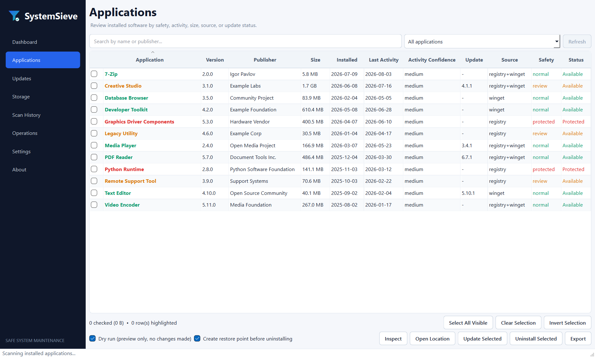
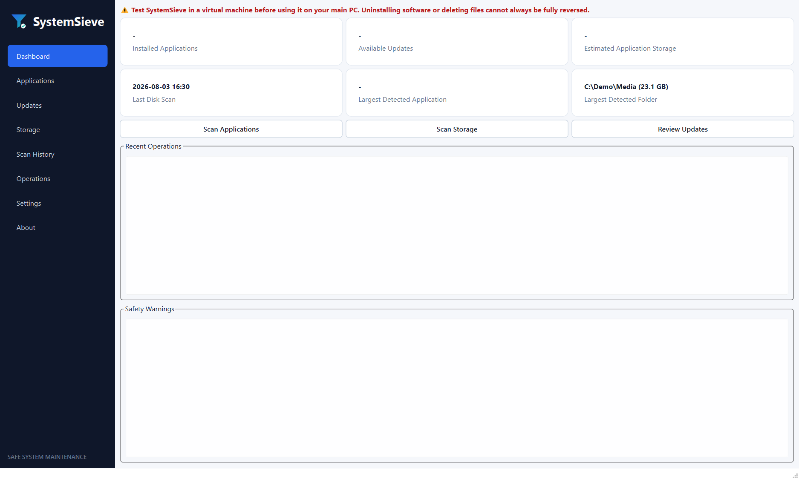
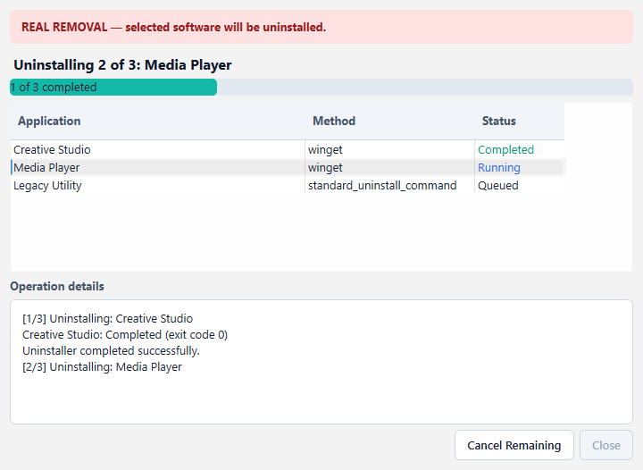

<p align="center">
  
</p>

<h1 align="center">SystemSieve</h1>

<p align="center">
  A safety-first Windows utility for reviewing installed software, uninstalling and updating
  applications, and finding large files and folders.
</p>

<p align="center">
  <a href="https://github.com/MuhammadMuneeb007/systemsieve/actions/workflows/tests.yml"></a>
  <a href="https://github.com/MuhammadMuneeb007/systemsieve/actions/workflows/lint.yml"></a>
  <a href="LICENSE"></a>
</p>

> [!WARNING]
> SystemSieve can uninstall software and delete files. Test pre-release builds in a virtual
> machine first. Review every plan before execution and keep Preview Only enabled until you
> understand the proposed operation.

## Screenshots







Screenshots contain representative data and do not expose a real computer inventory.

## Highlights

- Application inventory from Windows registry sources and WinGet, with duplicate merging.
- Search, category filtering, sortable columns, multi-row selection, and full-cell checkboxes.
- Clear safety classification: normal, review required, protected, or unknown.
- Inspect details, open install locations, and reveal files in Windows Explorer.
- Uninstall through WinGet, MSI, or validated vendor uninstallers.
- Persistent uninstall progress with queued, running, completed, failed, and cancelled states.
- WinGet update discovery and dry-run previews.
- Cancellable storage scans with large, old, recent, and categorized file views.
- Recycle Bin deletion by default and protected-path enforcement.
- Local SQLite history with no telemetry or analytics.
- Both graphical and command-line interfaces.

## Install the Windows release

1. Open the [latest GitHub release](https://github.com/MuhammadMuneeb007/systemsieve/releases/latest).
2. Download `SystemSieve-Windows-x64-v0.1.1.zip`.
3. Extract the entire ZIP to a normal folder.
4. Run `SystemSieve.exe` from the extracted folder.

Do not move the EXE out of its extracted folder: the standalone build requires the bundled
`_internal` files beside it.

> [!IMPORTANT]
> The current executable is unsigned. Windows SmartScreen may show an unrecognized publisher
> warning. Public production releases should be code-signed.

## Install with Python

SystemSieve requires Windows 10/11 and Python 3.11 or newer.

Install directly from GitHub:

```bat
py -m pip install "git+https://github.com/MuhammadMuneeb007/systemsieve.git@main"
systemsieve doctor
systemsieve gui
```

Or clone it for development:

```bat
git clone https://github.com/MuhammadMuneeb007/systemsieve.git
cd systemsieve
py -m venv .venv
.venv\Scripts\activate
py -m pip install -e ".[dev]"
systemsieve gui
```

After a package is published to PyPI, installation will be:

```bat
py -m pip install systemsieve
```

## Safe GUI workflow

1. Select applications using checkboxes or highlighted rows.
2. Keep **Preview only - no software will be removed** enabled for the first run.
3. Review the exact uninstall method and command.
4. For real removal, disable Preview Only and confirm the warning.
5. Follow the operation window for restore-point, UAC, installer, and final-result status.

All long-running inventory, WinGet, update, uninstall, and storage operations run outside the
UI thread so the interface remains responsive.

## Command-line examples

```bat
systemsieve doctor
systemsieve apps list
systemsieve apps inspect "7-Zip"
systemsieve apps updates
systemsieve apps uninstall "Example App"
systemsieve apps uninstall "Example App" --execute
systemsieve disk scan "C:\Users\you\Downloads"
systemsieve history operations
```

Destructive CLI commands default to dry-run mode. Real changes require `--execute`; interactive
confirmation remains enabled unless `--yes` is also supplied.

## Safety and privacy

- Commands use validated argument arrays with `shell=False`.
- Protected Windows components and dangerous deletion targets are blocked.
- The main application does not run elevated; only a validated operation requests UAC.
- Script-based uninstallers are not executed automatically.
- Inventory, scan, and operation history stays on the local computer.
- No telemetry or analytics is collected.

Read [Safety](docs/safety.md), [Privacy](docs/privacy.md), and
[Security reporting](SECURITY.md) before release use.

## Build and test

```bat
powershell -ExecutionPolicy Bypass -File ".\scripts\test.ps1"
powershell -ExecutionPolicy Bypass -File ".\scripts\build_windows.ps1"
```

The standalone output is written to `dist\SystemSieve\`. See
[Release instructions](docs/release.md) and [VM testing](docs/testing.md).

## Current limitations

- WinGet integration depends on the installed WinGet version and its text output.
- Activity evidence is conservative and is not proof that an application was or was not used.
- Vendor uninstallers may open their own wizard and require interaction.
- Leftover registry entries and application folders are not automatically removed.
- The current Windows build is not code-signed.

## Contributing and licence

See [CONTRIBUTING.md](CONTRIBUTING.md). SystemSieve is available under the
[MIT License](LICENSE).

SystemSieve is provided without warranty. Uninstalling software or deleting files may not be
fully reversible, even when a restore point is requested.
